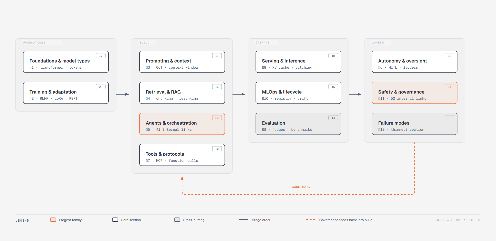
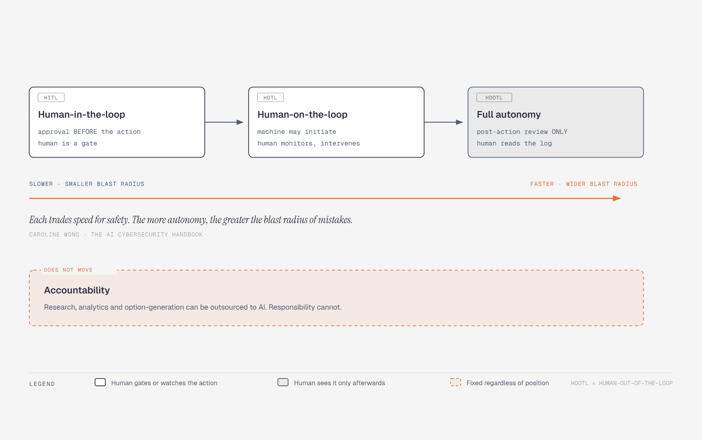
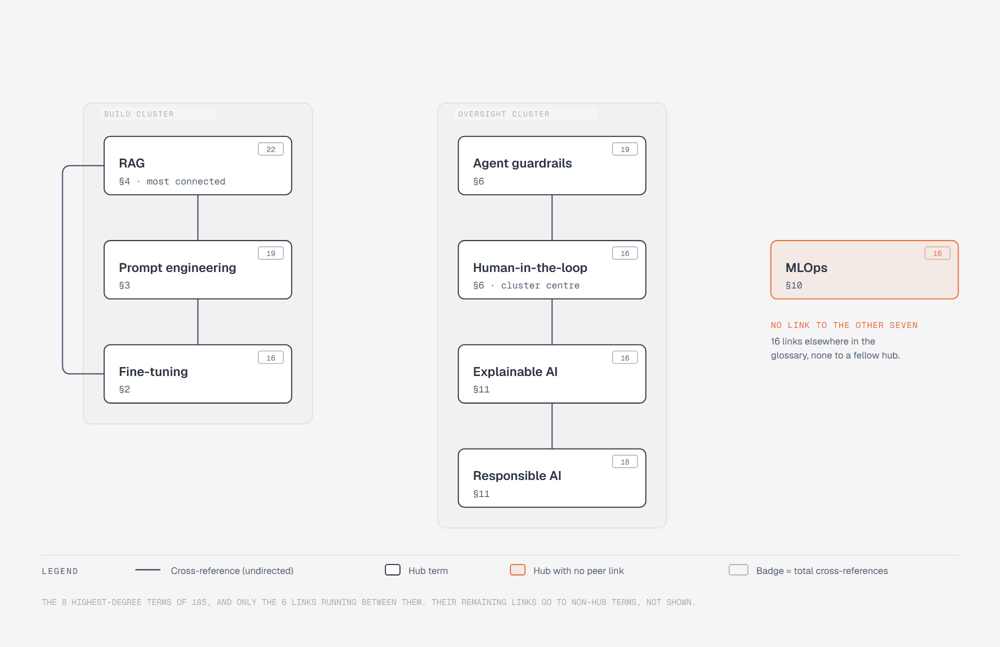

# AI Terminology

A working glossary of 186 AI terms across 12 sections. Each term is glossed from a named source and cites it, across 153 books and 22 engineering articles. Two entries are exceptions, noted at the end.

It also records two things a dictionary usually leaves out: words that carry two unrelated meanings in this field, and phrases in common circulation that none of these books define.

---

## The field

Twelve families, four stages. The badge on each box is the number of terms in that section. Agents and orchestration (§5) and safety and governance (§11) are the two largest, and governance is the one stage that feeds backwards: what you are allowed to ship constrains what you build.

---

## Where the human sits

Arguments about AI autonomy usually turn on this one distinction. There is a settled three-position vocabulary for it.

- **Human-in-the-loop (HITL)** — approval required before enforcement.
- **Human-on-the-loop (HOTL)** — machines may initiate actions, but humans monitor and intervene as needed.
- **Full autonomy** — post-action human review only.

> Each trades speed for safety. The more autonomy, the greater the blast radius of mistakes.
>
> — Caroline Wong, *The AI Cybersecurity Handbook*

HITL and HOTL get used interchangeably and they are not the same. Leonid Kuligin is explicit that HOTL is oversight through *monitoring*: the implementations look alike because the annotation surfaces resemble each other, but the goals differ.

Wong draws the accountability line in the same book:

> We can outsource research, analytics, and option-generation to AI, but not responsibility, and never accountability.
>
> — Caroline Wong, *The AI Cybersecurity Handbook*

---

## Four autonomy ladders that do not agree

The books contain four separate graded models. They are not variants of one scheme, and treating them as interchangeable is a common mistake. Pick one deliberately and say which you mean.

| Model | Rungs | Source |
|---|---|---|
| Five-level business framework | prompt-based assistance → workflow automation → tool access → supervised autonomy → multi-agent | Liu, *Agentic AI Playbook*, Ch. 2 |
| Three-rung engineering ladder | assist → supervised → semi-autonomous | Andrei, *Agentic AI Systems*, Ch. 1 |
| SAE driving analogy | six levels, Level 0 fully manual → Level 5 fully autonomous | Bornet & Wirtz, *Agentic Artificial Intelligence* |
| Approval regimes for a coding agent | untrusted → progressively trusted, set by sandbox and approval flags | Vaughan, *Codex CLI*, Ch. 9 |

Two rules recur across all four, and both argue against starting high:

> Start with the lowest level of autonomy that can reliably solve the problem... Reliable results at a lower level are always better than unreliable results at a higher one.
>
> — Helena Liu, *Agentic AI Playbook*

> Think of autonomy as a ladder, not a switch.
>
> — Patrick A. Andrei, *Agentic AI Systems*, Ch. 1

Andrei is blunt about why it matters: "Many failures blamed on 'hallucinations' are governance failures. The system was allowed to act without clear stopping conditions, without verification, or without a safe exit."

For the operating model that follows, Trevoir Williams states it as a sequence: let AI assist, let humans decide, let automation execute, then validate the results.

---

## One word, two meanings

Five words carry two unrelated meanings. When a conversation about AI goes in circles, it is usually one of them.

| Word | Meaning A | Meaning B |
|---|---|---|
| `inference` | Running a trained model to get a prediction | Drawing conclusions from data under uncertainty |
| `bias` | The bias-variance tradeoff, a statistical property of a model class | Unfair or discriminatory behaviour toward groups of people |
| `supervised` | A learning paradigm that uses labelled data | An autonomy rung where a human approves consequential actions |
| `guardrail` | A runtime control on model input and output | An automatic data-quality check inside a training job |
| `augmentation` | Enhancing human work with AI | Synthetically expanding a training set |

Terms affected by one of them carry a two meanings link in the glossary below.

---

## Five phrases in circulation, and what backs them

Phrases like these get used as if they were an agreed scale. Three are well sourced. Two are not, and it is worth knowing which, because a reader who looks them up will not find them.

| Phrase | Status | Nearest sourced term |
|---|---|---|
| **automated** | Sourced | Deterministic automation: fixed, predetermined tool chains that run the same steps regardless of results. Yildirim frames the move to agents as "a shift from checklists to cognition". |
| **AI-augmented** | Sourced | *Augmentation*, the middle of a three-mode value taxonomy: automation replaces process steps, augmentation enhances human work, data exploration uncovers insight. |
| **human-approved** | Sourced, as a mechanism | Human-in-the-loop: "approval required before enforcement". The *supervised* rung is tighter: approval before anything "external, costly, irreversible, or reputation sensitive". |
| **human-led** | **Not a defined level** | The *assist* rung: "the agent drafts and proposes, and a human decides and executes". |
| **exception-led** | **In none of these books** | *Supervised autonomy*: the agent acts on routine cases within clear rules and escalates exceptions. The idea is well sourced; the phrase is not the books' own. |

If you are building a framework and want these as your rung names, they work. Just expect readers to meet the sourced vocabulary instead.

---

## How the terms connect

The glossary's terms cross-reference each other 516 times. Those links are not evenly spread: the eight most-referenced terms fall into two clusters that barely touch.

One cluster is about getting a model to produce the right output: retrieval, prompting, fine-tuning. The other is about being allowed to ship it: guardrails, human oversight, explainability, responsible AI. MLOps is the eighth hub and links to neither, despite 16 links elsewhere.

---

## Contents

1. [Foundations and model types](#1-foundations-and-model-types) · 15 terms
2. [Training and adaptation](#2-training-and-adaptation) · 22 terms
3. [Prompting and context engineering](#3-prompting-and-context-engineering) · 11 terms
4. [Retrieval and RAG](#4-retrieval-and-rag) · 16 terms
5. [Agents and orchestration](#5-agents-and-orchestration) · 22 terms
6. [Autonomy and human oversight](#6-autonomy-and-human-oversight) · 12 terms
7. [Tools, protocols and integration](#7-tools-protocols-and-integration) · 10 terms
8. [Evaluation and measurement](#8-evaluation-and-measurement) · 14 terms
9. [Serving and inference](#9-serving-and-inference) · 19 terms
10. [MLOps and the model lifecycle](#10-mlops-and-the-model-lifecycle) · 16 terms
11. [Safety, security and governance](#11-safety-security-and-governance) · 24 terms
12. [Failure modes](#12-failure-modes) · 5 terms

---

### 1. Foundations and model types

_15 terms._

**Large Language Models** — Large language models are transformer-based models pretrained on very large text corpora, coming in three architectural shapes — encoder-only, decoder-only, and encoder-decoder — trained on web-scale datasets such as Common Crawl, C4, The Pile, and... *AI at Work: How to Build a Full-Stack Organization* · *Generative AI for Cloud Solutions* · +6 more

**Foundation Models** — Foundation models are very large models pretrained on broad data and then reused across many downstream tasks — one model serving many tasks, in place of a separate task-specific model per problem. *Azure AI Services at Scale for Cloud, Mobile, and Edge* · *Azure OpenAI Service for Cloud Native Applications* · +6 more

**Transformer Architecture** — The Transformer is a neural-network architecture (Vaswani et al., 2017) built around self-attention. *AI at Work: How to Build a Full-Stack Organization* · *AI-Assisted Programming* · +17 more

**Attention Mechanism** — Attention is the mechanism that lets a sequence model compute a weighted combination over all positions at once instead of threading state through a recurrence. *Explainable AI for Practitioners* · *Hands-On Machine Learning with Scikit-Learn and PyTorch* · +3 more

**Self-Attention** — The core transformer mechanism. Each token in a sequence projects to three vectors via learned weight matrices. *ML and Generative AI in the Data Lakehouse*

**Tokenization** — Tokenization converts raw text into the discrete units a language model actually operates on, using subword algorithms (BPE, WordPiece, SentencePiece) that sit between character-level and word-level splitting. *Future Money* · *Natural Language Processing with Transformers*

**Embeddings** — An embedding is a learned dense vector representation of sparse, high-cardinality input — words, but equally users, products, or geographic entities — placing semantically similar items near each other. *Data Engineering with Generative and Agentic AI on AWS* · *Generative AI on Google Cloud with LangChain* · +4 more

**Embedding Models** — Models that convert text into dense numerical vectors capturing semantic meaning. Azure OpenAI Essentials Ch. 3 differentiates OpenAI's `text-embedding-ada-002`, `text-embedding-3-small`, and `text-embedding-3-large` on dimensionality... *Azure OpenAI Essentials*

**Multimodal AI** — Multimodal AI covers models that generate or reason across more than one modality — text, image, audio. *Data Engineering for Multimodal AI* · *Generative AI on AWS* · +3 more

**Diffusion Models** — Diffusion models are generative models that learn to synthesize data by reversing a gradual noising process. *Generative AI Foundations in Python* · *Hands-On Generative AI with Transformers and Diffusion Models* · +3 more

**Mixture of Experts** — Mixture of Experts (MoE) is a model architecture that replaces a dense layer with many parallel "expert" sub-networks plus a learned **gating** function that, per token, routes computation to only a small subset of experts. *DeepSeek in Practice*

**LLM Model Types** — The progression of LLM variants by training stage: **base** (pretrained next-token predictor), **instruction-fine-tuned** (RLHF/SFT-tuned to follow instructions and chat), and **domain-adapted** (further trained on specialized corpora). *Large Language Models: The Hard Parts*

**LLM Context Features** — The set of operational model attributes an LLMBA builder weighs when selecting an open model, beyond raw quality. *Large Language Models: The Hard Parts*

**LLM Inference Parameters** — LLM inference parameters are the sampling controls applied to a model's output-token probability distribution at generation time. *Learn Mistral*

**Scaling Laws** — Scaling laws describe how model performance (loss) predictably improves as a function of model size, dataset size, and training compute, following power-law relationships. *LLMOps*

[back to top](#contents)

### 2. Training and adaptation

_22 terms._

**LLM Pretraining** — LLM pretraining is the first, most compute-intensive training stage: a Transformer is trained on a very large unlabeled text corpus with a self-supervised next-token objective, learning general language and world knowledge before any task-specific... *Designing Large Language Model Applications* · *The Hundred-Page Language Models Book*

**Fine Tuning** — The process of adapting a pre-trained model to a target task, domain, or instruction style by continuing training on a smaller dataset. *Building Agentic AI* · *GenAI on Google Cloud* · +8 more

**Parameter-Efficient Fine-Tuning (PEFT)** — Parameter-efficient fine-tuning (PEFT) adapts a large pretrained model by training only a small set of new or selected parameters while freezing the original weights — capturing most of the gains of full fine-tuning at a fraction of the compute and... *Deep Learning at Scale* · *Generative AI Foundations in Python* · +3 more

**LoRA Fine Tuning** — LoRA (Low-Rank Adaptation) fine-tuning trains a small set of low-rank adapter matrices injected into a frozen base model, rather than updating all parameters. *Machine Learning Engineering on AWS* · *Privacy and Security for Large Language Models*

**QLoRA** — QLoRA builds on by adding quantization: it applies quantization (including blockwise quantization internals) to lower the memory footprint of fine-tuning while still learning low-rank adapters on task-specific data. *LLMs for Modern Software Delivery and DevOps*

**RLHF** — A post-training technique that fine-tunes a language model's outputs toward human preferences using a learned reward model, traditionally applied after a pretrain → supervised-fine-tuning (SFT) pipeline. *DeepSeek in Practice* · *Vision Language Models*

**Reinforcement Learning** — Reinforcement learning trains an agent to choose actions that maximize cumulative reward through interaction with an environment — framed formally as Markov decision processes, or practically as goal-centric reward shaping ("a few points for moving... *Data Mining* · *Data-Driven Modeling & Scientific Computation* · +8 more

**Deep Reinforcement Learning** — Deep reinforcement learning uses neural networks as the function approximator inside RL — either for the value function or for the policy itself. *Fundamentals of Deep Learning* · *TensorFlow 2 Reinforcement Learning Cookbook*

**Transfer Learning** — Transfer learning is the reuse of a model pretrained on a large general dataset as the starting point for a different, usually smaller, downstream task. *Applied Machine Learning and AI for Engineers* · *Azure AI Services at Scale for Cloud, Mobile, and Edge* · +6 more

**Knowledge Distillation** — Knowledge distillation trains a smaller "student" model to reproduce a larger "teacher" model's behavior, compressing model size while retaining much of its accuracy. *Natural Language Processing with Transformers*

**Model Distillation** — Model distillation transfers a large "teacher" model's capabilities into a smaller "student" model by training the student on the teacher's outputs. *DeepSeek in Practice*

**Model Quantization** — Quantization lowers the numeric precision of a model's weights and often its activations to cut memory footprint and inference latency, at some accuracy cost. *AI at the Edge* · *Building Agentic AI* · +1 more

**Distributed Training** — Distributed training runs a single training job across many devices — and usually many machines — coordinating them with **collective operations** rather than shared memory. *Deep Learning at Scale* · *Deep Learning with Azure* · +9 more

**Data Parallelism** — Data parallelism (DP) replicates the **full model on every device**, gives each replica a different slice of the batch, and synchronizes gradients across replicas so every copy stays identical. *Deep Learning at Scale*

**Model Parallelism** — Model parallelism splits the **computation** of a single forward/backward pass across devices, so that one sample's pass requires several GPUs to complete. *Deep Learning at Scale*

**Hyperparameter Tuning** — Hyperparameter tuning (HPO) is the search over model configuration values that are not learned during training — learning rate, tree depth, layer sizes, regularization strength — evaluated by running repeated train-and-validate trials over a... *Automated Machine Learning on AWS* · *Data Science on AWS* · +8 more

**Hyperparameter Optimization** — Hyperparameter optimization (HPO) is the automated search over the configuration values a model does not learn from data — learning rate, depth, regularization strength — under a fixed time or compute budget. *Automated Machine Learning* · *Learning AutoML* · +1 more

**Continual Learning** — Keeping a deployed model current as data shifts. Designing Machine Learning Systems Ch. 9 draws the central distinction between stateless retraining (full retrain from scratch on fresh data) and stateful training (incrementally updating... *Designing Machine Learning Systems*

**Curriculum Learning** — Training an agent on progressively harder versions of a task instead of the full difficulty from the start. *Practical Simulations for Machine Learning*

**Mixed Precision Training** — Mixed precision training runs most neural-network computation in lower-precision floating point (FP16 or BF16) while keeping numerically sensitive operations (weight updates, loss scaling) in FP32, exploiting dedicated hardware like CUDA tensor... *Deep Learning at Scale*

**LLM Alignment** — Shaping a model's **internal tendencies** so its outputs match a desired policy, as distinct from filtering outputs externally at runtime. *Large Language Models: The Hard Parts*

**Constitutional AI** — Anthropic's alignment method that replaces human preference labels with AI-generated ones against an explicit written set of principles (a "constitution"). *Agentic AI Playbook* · *Large Language Models: The Hard Parts*

[back to top](#contents)

### 3. Prompting and context engineering

_11 terms._

**Prompt Engineering** — Prompt engineering is the disciplined design of LLM inputs — instructions, context, examples, output schema, and inference parameters — to steer model behavior toward reliable, structured results without changing the model itself. *AI-Assisted Programming* · *Agentic Coding with Claude Code* · +17 more

**Context Engineering** — Context engineering is the discipline of treating an agent's context window as a finite, precious resource and deliberately curating what enters it. *AI Agents on AWS* · *Agentic Coding with Claude Code* · +4 more

**In Context Learning** — In-context learning (ICL) is an LLM's ability to perform a new task purely from instructions and examples placed in the prompt at inference time, without any weight updates. *Generative AI Foundations in Python*

**Few Shot Prompting** — Few-shot prompting is supplying a small set of worked input/output pairs inside the prompt so the model infers the intended format and style from demonstration rather than from instruction. *Prompt Engineering for Generative AI*

**Few Shot Learning** — Few-shot learning is adapting a model to a task when only a handful of labeled examples exist. *Natural Language Processing with Transformers*

**Chain-of-Thought (CoT)** — Having a model emit intermediate reasoning steps before its final answer. DeepSeek in Practice Ch. 2 covers both CoT and "long CoT", where the reasoning is structured into explicit `<think>` and `<answer>` blocks — an architectural... *DeepSeek in Practice*

**Context Compaction** — Context compaction is summarizing or clearing an agent's near-full context and reinitializing it, so a long-running agent can keep working without exhausting its context window. *Claude Code Power User Customization: How to Configure Hooks* · *Effective Context Engineering for AI Agents* · +2 more

**Prompt Caching** — Prompt caching reuses the computation for a frequently-sent prompt prefix across API calls, so repeated context is not re-processed on every roundtrip. *Lessons From Building Claude Code: Prompt Caching Is Everything* · *Prompt Caching with Claude*

**CLAUDE.md** — CLAUDE.md is a special configuration/memory file that gives Claude Code persistent, project-specific context — architecture, conventions, build/test commands, tooling, and workflows — so you don't re-explain them every conversation. *Lessons From Building Claude Code: Prompt Caching Is Everything* · *Using CLAUDE.md Files: Customizing Claude Code for Your Codebase*

**AGENTS.md** — A markdown instruction file that a coding agent loads from the repository root and from subdirectories to pick up project-specific context. *Codex CLI: Agentic Engineering from First Principles*

**Image Generation Prompting** — Image generation prompting is the practice of crafting text prompts to steer diffusion-based text-to-image models. *Prompt Engineering for Generative AI*

[back to top](#contents)

### 4. Retrieval and RAG

_16 terms._

**Retrieval Augmented Generation** — RAG grounds an LLM's generation in external knowledge by retrieving relevant chunks from a vector or keyword index at query time and injecting them into the prompt as context. *AI at Work: How to Build a Full-Stack Organization* · *AI-Assisted Programming* · +31 more

**Agentic RAG** — Retrieval-augmented generation in which an agent decides *when and what* to retrieve — issuing retrieval as a tool call inside a reasoning loop — rather than running a fixed retrieve-then-generate pipeline. *Agentic AI for Cybersecurity* · *Hands-On RAG for Production* · +2 more

**Data Chunking** — Chunking is the splitting of source documents into retrieval units before they are embedded into a vector store. *AI-Ready Data Blueprints*

**Semantic Chunking** — Semantic chunking is a document-splitting strategy for RAG pipelines that groups text by meaning rather than by fixed character/token counts — splitting where topic or embedding similarity between adjacent sentences drops, as opposed to character,... *RAG from First Principles* · *RAG with Python Cookbook*

**RAG Chunking** — The step in a RAG pipeline that splits preprocessed documents into retrievable units. The book lays out a taxonomy. *Large Language Models: The Hard Parts*

**Hybrid Search** — Retrieval that combines dense vector similarity with sparse keyword matching and fuses the two score sets into one ranking. *Hands-On RAG for Production* · *RAG from First Principles* · +2 more

**Semantic Search** — Retrieval by meaning rather than by token match: content and query are both embedded, and results are ranked by distance in the embedding space. *Learn Mistral* · *Vector Databases*

**Vector Search** — Nearest-neighbour retrieval over an index of embedding vectors. Both sources treat it as a backend-selection problem rather than an algorithm. *Azure OpenAI Service for Cloud Native Applications* · *Generative AI on Google Cloud with LangChain* · +1 more

**Vector Database** — A store that indexes and answers similarity queries over them — the retrieval substrate of a RAG pipeline, sitting between and the generator. *AI-Ready Data Blueprints* · *Data Engineering with Generative and Agentic AI on AWS* · +6 more

**Approximate Nearest Neighbor** — Retrieval of vectors that are near a query without guaranteeing the exact nearest, trading recall for speed and memory. *Vector Databases*

**HyDE** — HyDE (Hypothetical Document Embeddings) is a retrieval technique where an LLM first generates a hypothetical answer document for a query, then that hypothetical document — not the raw query — is embedded and used to search, closing the semantic gap... *RAG from First Principles* · *RAG with Python Cookbook*

**Knowledge Graph** — A knowledge graph stores entities as nodes and their relationships as typed edges, so retrieval can traverse connections rather than only match text. *RAG from First Principles* · *RAG with Python Cookbook* · +2 more

**Long Context vs RAG** — The design decision between two ways of supplying an LLMBA with knowledge: **RAG** (retrieve and inject only the relevant chunks at query time) versus **long-context models (LCMs)** that load the entire corpus into a large context window (optionally... *Large Language Models: The Hard Parts*

**RAG With Citations** — "RAG done right" — a retrieve → summarize → cite → act discipline over a curated, minimum-viable knowledge base (chunked by headings), where citations are mandatory and conflicts are resolved by an explicit source-quality rubric (source type,... *Agentic AI Systems*

**Entity Resolution** — Entity resolution is the process of determining that records from different sources referring to the same real-world financial entity (a company, security, or counterparty) are in fact the same, using rule-based, probabilistic, or deep-learning... *Data Engineering for Multimodal AI* · *Financial Data Engineering*

**Semantic Layer** — The layer that sits between physical storage and consumers, expressing data in business terms rather than table shapes. *AI-Ready Data Blueprints* · *Azure Data and AI Architect Handbook* · +1 more

[back to top](#contents)

### 5. Agents and orchestration

_22 terms._

**AI Agents** — An AI agent is an LLM-driven system that runs a perceive-reason-act-learn loop, built from five components — the model, memory, planning, tools, and reflection. *AI at Work: How to Build a Full-Stack Organization* · *Agentic Coding with Claude Code* · +7 more

**Agentic AI** — An agent is best defined by **control flow, not capability**: an LLM generates text, RAG generates *grounded* text, tool use connects the model to external capabilities, and an agent *decides, acts, observes, and continues through a controlled loop*... *AWS for Solutions Architects (3 ed.)* · *Agentic AI for Cybersecurity* · +6 more

**Agent As Controlled Loop** — The reframing of an AI agent as a deterministic cycle — Input → Interpretation → Planning → Action (tool or draft) → Observation → State Update → Next Step, then repeat or finish — rather than a "smart personality". *Agentic AI Systems*

**ReAct Agent Pattern** — A reasoning framework for LLM agents that interleaves explicit reasoning steps with actions (tool calls) and observations of their results, letting the model adjust its plan based on what each action returns rather than committing to a fixed... *Building Agentic AI*

**Multi Agent Systems** — A multi-agent system is one in which several LLM-driven agents work on a task together under an explicit coordination scheme rather than as a single agent loop. *Agentic AI for Cybersecurity* · *Agentic Artificial Intelligence* · +5 more

**Multi Agent Orchestration** — The practice of wiring multiple agents (or multiple sessions of one agent) into a coordinated system rather than relying on a single agent loop. *Agentic Coding with Claude Code* · *Codex CLI: Agentic Engineering from First Principles*

**Multi Agent Communication Styles** — Multi-agent communication styles describe how data flows between agents in a multi-agent system, classified into three concrete patterns. *AI Agents on AWS* · *Agentic AI Playbook*

**Agent Coordination Patterns** — Structural patterns for composing multiple agents/workflows into a larger system. Yıldırım distills three core forms. *Agentic AI for Offensive Cybersecurity*

**Supervisor-Worker Pattern** — The supervisor-worker pattern is a multi-agent topology in which a supervisor agent coordinates specialized worker agents. *AI Agents on AWS*

**Subagents** — Subagents are isolated Claude instances, each with their own fresh context window, system prompt, and tool permissions, that an orchestrator delegates a discrete task to — they do the work independently and return only the result. *Effective Context Engineering for AI Agents* · *How and When to Use Subagents in Claude Code* · +2 more

**Agent Memory** — The persistence layer that lets an agent carry state across steps and across sessions, split into short-term memory (the working context of the current task) and long-term memory (what survives to inform later ones). *Agentic Artificial Intelligence*

**Agent Memory Types** — A taxonomy of agent memory grounded in the CoALA framework: **short-term / working memory** (the context window, held as a rolling buffer) plus **long-term memory** split into **episodic** (case-based reasoning over past events), **semantic**... *AI Agents on AWS*

**Agent Memory vs State** — The separation of short-term **session state** (the per-run workbench: goal, constraints, plan, execution record, open questions, assumptions) from **long-term memory** (durable knowledge persisted across runs under an explicit schema. *Agentic AI Systems*

**Agent Skills** — Agent Skills (a.k.a. Claude Skills / Claude Code Skills) are organized folders of instructions, scripts, and resources that an agent discovers and loads dynamically to specialize at a task — "like an onboarding guide for a new hire". *Building Agents with Skills: Equipping Agents for Specialized Work* · *Code Execution with MCP: Building More Efficient Agents* · +2 more

**Agent Design Process** — The end-to-end method for taking an AI agent from opportunity to a system that runs in the business. *Agentic AI Playbook* · *Agentic Artificial Intelligence*

**Agent Job Description** — A one-sentence operator contract for an agent of the form: "It owns X outcome, under Y constraints, and it must produce Z artifacts every run". *Agentic AI Systems*

**Agent As Tool Composition** — Agent-as-tool composition wraps a complete agent so it presents the same interface as an ordinary tool — in AWS Strands via `.as_tool()` — making the agent a callable, reusable unit. *AI Agents on AWS* · *Codex CLI: Agentic Engineering from First Principles*

**A2A (Agent-to-Agent Protocol)** — A2A (Agent-to-Agent) is Google's open protocol for standardizing communication *between* autonomous agents, where MCP standardizes communication between an agent and its tools. *AI Agents on AWS* · *Agentic AI for Cybersecurity*

**Agentic AI vs Traditional Automation** — The distinction between deterministic automation (fixed, predetermined tool chains — e.g. a scripted Nmap → subfinder pipeline that runs the same steps regardless of results) and agentic AI, where an LLM interprets a goal, selects the next tool,... *Agentic AI Playbook* · *Agentic AI for Offensive Cybersecurity*

**Workflows vs Agents** — A hybrid architectural stance: hardcode the deterministic path as a workflow and agent-ify only the ambiguous decisions — "agent for decision points, workflow for deterministic execution". *Agentic AI Systems*

**Harness Engineering** — The discipline of designing the infrastructure, constraints, and feedback loops that make AI agents reliably productive — "one level up" from both software engineering (which designs code) and prompt engineering (which designs instructions for a... *Codex CLI: Agentic Engineering from First Principles*

**Agent Observability** — The discipline of making an agent run reconstructable, keyed by a **run ID** as spine, capturing a minimal-but-strict log schema. *Agentic AI Systems*

[back to top](#contents)

### 6. Autonomy and human oversight

_12 terms._

**Human-in-the-Loop (HITL)** — Human-in-the-loop (HITL) is the design pattern of inserting a human review or approval step into an agent's workflow rather than letting it act fully autonomously. *AI at Work: How to Build a Full-Stack Organization* · *Agentic AI Playbook* · +2 more

**Autonomy Ladder** [two meanings](#one-word-two-meanings) — A graded progression of agent independence — assist → supervised → semi-autonomous — framed as "a ladder you earn by demonstrating the loop can stop". *Agentic AI Playbook* · *Agentic AI Systems*

**Agent Autonomy Levels** — A graded framework classifying how much independence an AI agent has — most commonly a five-level progression. *Agentic AI Playbook* · *Agentic Artificial Intelligence*

**Agent Approval Ladder** — The set of trust regimes a terminal coding agent runs under, deciding which actions proceed automatically and which require explicit human approval. *Codex CLI: Agentic Engineering from First Principles*

**Autonomous AI** — Flexible, real-time-adapting decision-making systems, defined in Designing Autonomous AI's Introduction as distinct from rigid automated systems such as Dijkstra's algorithm or expert systems. *Designing Autonomous AI*

**Human Agent Collaboration** — The practice of running hybrid teams in which AI agents and people share the work. Agentic Artificial Intelligence Ch. 10 is the library's most direct treatment, and frames it as a leadership problem — work design, trust, change... *Agentic Artificial Intelligence* · *The Agentic Enterprise*

**Human Machine Collaboration** — Human-machine collaboration, per Radically Human, is framed as a "third stage" of AI adoption — following stage 1 (automation/replacement) and stage 2 (collaborative augmentation) — in which humans remain in the ascendant even... *Radically Human*

**Automation / Augmentation / Data Exploration** [two meanings](#one-word-two-meanings) — A three-mode taxonomy of how AI creates value, from AI Innovation in Business Ch. 2's "five habits of highly effective AI organizations". *AI Innovation in Business*

**Stop List and Approval Rules** — The "stop list" is a set of hard boundaries an agent may never cross — canonical examples. *Agentic AI Systems*

**Agent Guardrails** [two meanings](#one-word-two-meanings) — A layered control system that keeps an agent inside defined bounds: four permission tiers per tool action (read-only / draft-only / execute-with-approval / auto-execute), two-step confirmation gates for irreversible actions (payload preview +... *Agentic AI Playbook* · *Agentic AI Systems*

**Runtime Guardrails** [two meanings](#one-word-two-meanings) — Controls applied to an LLMBA at inference time (as opposed to dev-time benchmarks) to filter, constrain, or block unsafe inputs and outputs in production. *Large Language Models: The Hard Parts*

**Agent Sandboxing** — Agent sandboxing contains an agent's execution within OS-level boundaries so it can work freely inside them while its blast radius is capped from the outside. *Beyond Permission Prompts: Making Claude Code More Secure and Autonomous* · *How We Contain Claude Across Products*

[back to top](#contents)

### 7. Tools, protocols and integration

_10 terms._

**Model Context Protocol (MCP)** — An open protocol (introduced by Anthropic in late 2024) that standardizes how LLM applications connect to external tools and data, acting as a "universal adapter" that eliminates per-tool custom integrations. *AI Agents on AWS* · *Agentic AI for Cybersecurity* · +8 more

**Function Calling** — The mechanism by which a model, given a set of declared function specifications, emits a structured request naming one of them and supplying arguments — a **controlled contract** between the model and the application rather than a form of execution. *Azure OpenAI Essentials*

**Agent Tool Use** — Tool use is the rung where a model stops producing text and starts reaching external capability — but the mechanics are narrower than the phrase suggests. *Agentic Artificial Intelligence*

**Programmatic Tool Calling** — Programmatic tool calling (PTC) has the model invoke tools by *writing and executing code* in a sandbox rather than emitting one tool-call JSON object per step. *Code Execution with MCP: Building More Efficient Agents* · *Introducing Advanced Tool Use on the Claude Developer Platform*

**MCP Tool Design Methodologies** — A comparative framework for how much offensive methodology to embed in an MCP tool versus delegate to the LLM. *Agentic AI for Offensive Cybersecurity*

**MCP vs A2A** — MCP (Model Context Protocol) and A2A (Agent-to-Agent) are complementary open protocols operating at different layers. *AI Agents on AWS*

**Claude Plugins** — Claude plugins are single-command-installable packages that bundle customizations so they can be shared and distributed. *Customize Claude Code with Plugins* · *Customize Cowork with Plugins*

**Claude Code Hooks** — Hooks are deterministic handlers that fire on Claude Code lifecycle events — file edits, tool calls, session start, compaction — to automate tasks, enforce rules, and inject context. *Claude Code Power User Customization: How to Configure Hooks* · *Steering Claude Code: CLAUDE.md Files, Skills, Hooks, Rules, Subagents and More*

**Kernel Level Agent Sandboxing** — Restricting what an autonomous coding agent can do at the operating-system layer rather than the application layer, so the restrictions are enforced by the kernel and cannot be bypassed by the agent. *Codex CLI: Agentic Engineering from First Principles*

**Managed Agents** — Claude Managed Agents is Anthropic's hosted service for running long-horizon agents: you define the tasks, tools, and guardrails, and Anthropic runs the agent plus its orchestration harness (tool-calling, context management, error recovery) on... *Claude Managed Agents: Get to Production 10x Faster* · *New in Claude Managed Agents: Run Agents on a Schedule and Store Environment Variables in Vaults* · +1 more

[back to top](#contents)

### 8. Evaluation and measurement

_14 terms._

**Model Evaluation** — Model evaluation is offline measurement of a trained model before it reaches production. Designing Machine Learning Systems Ch. 6 covers the full offline toolkit — baselines, evaluation metrics, calibration, behavioral testing, and... *Designing Machine Learning Systems* · *Journey to Become a Google Cloud Machine Learning Engineer*

**LLM Evaluation** — LLM evaluation is the measurement of generated-output quality where outputs are open-ended and ground truth is usually absent — the reason traditional metrics run out. *Architecting Generative AI Applications* · *Building Agentic AI* · +4 more

**LLM Evaluation Tools** — The open-source frameworks that operationalize LLMBA evaluation at scale: **LangSmith** (orchestration over `hf_evaluate`, golden-dataset workflows, `num_repetitions` for nondeterminism, production monitoring), **Promptfoo** (YAML-driven CLI,... *Large Language Models: The Hard Parts*

**LLM-as-a-Judge** — Using an LLM to score or rank other models' outputs against criteria, replacing or augmenting human evaluation. *Generative AI at AWS* · *Hands-On RAG for Production* · +3 more

**Evaluating Evaluators** — The meta-evaluation problem: when you use an LLM (or model) as a judge, how do you know the judge itself is reliable? The book points to two approaches. *Large Language Models: The Hard Parts*

**Evals Gap** — The book's coined term for the chasm between traditional deterministic software testing and the evaluation of nondeterministic LLM-based applications. *Large Language Models: The Hard Parts*

**Agent Evaluation Suite** — A fixed test set — 30 cases split 10 normal / 10 edge / 10 adversarial — scored with binary success against the agent's SLA, tracking KPIs of success rate, time to complete (including human review), tool error rate, and cost per task. *Agentic AI Systems*

**Agent Evaluation As Managed Service** — Bedrock AgentCore Evaluations is AWS's managed offering for evaluating agent behavior: it collects traces via AgentCore Observability, runs evaluation across defined levels, and supports custom evaluators. *AI Agents on AWS*

**Model Benchmarking** — Model benchmarking is the quantitative comparison of candidate models on a defined task using a suite of metrics — lexical (BLEU, ROUGE, METEOR), semantic (embedding cosine similarity), and domain-specific (CLIP score for image-text alignment). *Generative AI Foundations in Python*

**Safety Benchmarks (SALAD, TruthfulQA, HarmBench)** — The three dev-time safety benchmarks the book uses to measure an LLM before deployment: **SALAD-Bench** (21K samples on a 6/16/66 hierarchical harm taxonomy, plus 5K attack-enhanced questions, scored by MD-Judge and MCQ-Judge), **TruthfulQA**... *Large Language Models: The Hard Parts*

**BLEU ROUGE for LLMs** — The reuse of classic n-gram-overlap NLP metrics — **BLEU** (precision-oriented, from machine translation) and **ROUGE** (recall-oriented variants ROUGE-1/2/L/Lsum, from summarization) — as a first-pass quantitative measure of LLMBA output against... *Large Language Models: The Hard Parts*

**A/B Testing** — An A/B test is a controlled experiment with two treatments (A and B) — often a new option B against an established default A — in which data is collected so that any observed difference between the groups must be due to either random chance in the... *AI-Assisted Statistics for Data Scientists*

**Machine Learning Model Evaluation** — Machine learning model evaluation is the lifecycle stage — following model training — in which a model's predictive performance is assessed before it is trusted or deployed. *Cracking the Data Science Interview*

**SageMaker Ground Truth** — SageMaker Ground Truth is Amazon's managed data-labeling service: it lets teams stand up a private (or public/vendor) labeling workforce and run structured labeling jobs for images and text, producing training-ready labeled datasets. *Learn Amazon SageMaker*

[back to top](#contents)

### 9. Serving and inference

_19 terms._

**Model Serving** [two meanings](#one-word-two-meanings) — Model serving is the runtime layer that exposes a trained ML model behind a callable interface — typically a REST/gRPC endpoint, a batch transform job, or an in-process library — and handles the operational concerns around it. *Agile Data Science 2.0* · *Automated Machine Learning on AWS* · +13 more

**ML Model Serving** — ML model serving is exposing a trained model's predictions through an API for consumption by other systems. *Hands-On APIs for AI and Data Science*

**Model Serving Frameworks** — Model serving frameworks are specialized runtimes for deploying trained models — for LLMs specifically, frameworks like vLLM and TensorRT-LLM — compared in Hands-On LLM Serving and Optimization Ch. 8, with Ch. 3 grounding the comparison... *Hands-On LLM Serving and Optimization*

**LLM Inference** [two meanings](#one-word-two-meanings) — LLM inference is generating output from a trained language model at serving time, characterized by autoregressive (token-by-token) generation split into a compute-bound "prefill" phase (processing the prompt) and a memory-bandwidth-bound "decode"... *Hands-On LLM Serving and Optimization*

**ML Inference** [two meanings](#one-word-two-meanings) — ML inference is the process of running a trained model against new input to produce predictions. *AI at the Edge*

**Inference Optimization** — Inference optimization is the set of techniques for cutting the latency, memory footprint, and cost of serving a model without retraining it. *Generative AI at AWS* · *Generative AI for Cloud Solutions* · +5 more

**Continuous Batching** — Continuous (also called **in-flight**) batching is a scheduling policy for LLM serving in which the engine **evicts a finished request from the batch and admits a waiting one mid-flight**, rather than holding the batch fixed until every sequence in... *Distributed AI Systems* · *Mastering Large Language Models*

**Speculative Decoding** — Speculative decoding accelerates autoregressive generation by having a **small draft model propose N tokens ahead**, which the large target model then **verifies in a single forward pass**. *Distributed AI Systems* · *Mastering Large Language Models*

**KV-Cache Optimization** — The KV cache stores the key and value projections already computed for previous tokens so that each decode step computes K and V only for the **new** token. *Transformers: The Definitive Guide*

**Inference Time Compute** — Inference-time compute (test-time compute) is additional computation spent at inference — beyond a single forward pass — to improve output quality, via techniques like chain-of-thought scaling, self-consistency sampling, and process reward models. *Designing Large Language Model Applications*

**LLM Throughput Scaling** — LLM throughput scaling addresses growing request capacity on a managed LLM API without hitting rate limits — in Azure OpenAI, via quota management and Provisioned Throughput Units (PTU-M), a reserved-capacity purchase model sized against expected... *Azure OpenAI Essentials*

**Batch vs Real-Time Scoring** — The choice between scoring records in scheduled bulk versus on request. Automated Machine Learning with Microsoft Azure Ch. 8 codifies a five-step batch scoring procedure against a four-step real-time procedure, with explicit criteria... *Automated Machine Learning with Microsoft Azure*

**Batch vs Online Prediction** — Batch prediction precomputes model outputs for a known set of inputs on a schedule (hourly, nightly) and stores them in a database or feature store for later lookup.

**On Device Inference** — On-device inference is running a trained model's inference step locally on the device collecting the data, rather than sending that data to the cloud for processing. *AI at the Edge*

**LLM Deployment** — LLM deployment, per LLMOps framing, is the operational process of shipping an LLM-backed application to production — containerized, API-first, behind versioned gateways — as either a modular (composable services) or monolithic architecture,... *LLMOps*

**LLM Local Deployment** — LLM local deployment is running a language model entirely on local or on-premises hardware rather than a cloud API — e.g., via Ollama (model install/run, Modelfile customization for system prompts and moderation) paired with a local UI (Open WebUI... *Learn Mistral*

**LLM Cloud Deployment** — LLM cloud deployment is running large language models through managed cloud services — e.g., AWS Bedrock (IAM-gated model access, boto3 streaming, CloudWatch observability) or Google Vertex AI (Model Garden, Colab Enterprise, gcloud auth, Vertex SDK... *Learn Mistral*

**GPU Cluster Management** — GPU cluster management is the platform-operations work of provisioning, scheduling, and sizing GPU capacity for ML workloads on Kubernetes. *Kubeflow Operations Guide*

**Inference Cost Collapse** — The rapid, sustained decline in the cost of LLM inference: an a16z mid-2024 estimate of ~10x/year accelerated to **50–200x/year by early 2025**. *Large Language Models: The Hard Parts*

[back to top](#contents)

### 10. MLOps and the model lifecycle

_16 terms._

**MLOps** — The engineering discipline of running ML systems in production: pipelines, CI/CD, model registries, feature stores, monitoring, drift detection, and governance — i.e., the connective tissue that lets an ML org iterate on data and models without... *AWS for Solutions Architects (2 ed.)* · *Architecting Data and Machine Learning Platforms* · +36 more

**LLMOps** — LLMOps is the operational discipline for LLM-backed applications, extending MLOps with concerns that classical ML pipelines do not have. *AI-Ready Data Blueprints* · *Architecting Generative AI Applications* · +8 more

**ML Pipeline** — An ML pipeline is the orchestrated sequence that turns raw data into a deployed model — ingestion, preparation, feature engineering, training, evaluation, and serving — executed as versioned stages rather than as notebook steps. *Building Machine Learning Pipelines* · *Kubeflow for Machine Learning* · +5 more

**AI Pipeline** — The end-to-end sequence of steps an organization runs to turn data into a deployed AI capability. *The Secrets of AI Value Creation*

**Feature Engineering** — The discipline of transforming raw input data into the numeric, categorical, or embedding representations a model actually trains on. *Agile Data Science 2.0* · *Automated Machine Learning on AWS* · +13 more

**Automated Feature Engineering** — Machine generation of model features. Automated Machine Learning Ch. 2 subdivides it into feature extraction, feature selection, and feature generation/construction. *Automated Machine Learning*

**Feature Store** — A feature store is a shared registry in which features are computed once and consumed by both training pipelines and online serving, so the two paths cannot diverge — formalized as Pattern 26 in Machine Learning Design Patterns (~pp.... *Machine Learning Design Patterns* · *Architecting Data and Machine Learning Platforms* · +9 more

**Experiment Tracking** — Experiment tracking is the systematic logging of ML training runs — parameters, metrics, code versions, and artifacts — so experiments are reproducible and comparable. *Implementing MLOps in the Enterprise* · *Machine Learning Engineering on AWS*

**Mlflow Model Registry** — The MLflow Model Registry is the component that versions trained models and tracks their promotion through a lifecycle, decoupling "which model version exists" (training/tracking) from "which model version is live" (serving). *Databricks Certified Generative AI Engineer Associate Study Guide* · *Optimizing Databricks Workloads*

**Model Versioning** — Model versioning is Pattern 27 in Machine Learning Design Patterns (Ch. 6, ~pp. 305–325). *Machine Learning Design Patterns*

**Model Drift Detection** — Model drift detection identifies when a deployed model's performance degrades because the production data distribution has shifted from training — closing the production loop by signaling when retraining is needed. *Learning AutoML*

**Training Serving Skew** — The divergence between how features are computed during training and how they are computed at inference. *Building Machine Learning Pipelines* · *Data Science on the Google Cloud Platform*

**Canary Deployment** — A canary deployment releases a new version to a small slice of production traffic first, then progressively shifts more traffic to it as it proves healthy — 90-10, 75-25, 50-50 splits are typical staging points. *Bootstrapping Service Mesh Implementations with Istio* · *Consul: Up and Running* · +5 more

**Prototype to Production Pipeline** — A prototype-to-production pipeline is the transformation path from exploratory Jupyter/Colab notebooks to a production-deployed service, systematically replacing ephemeral conveniences with durable, versioned, observable infrastructure. *Generative AI Foundations in Python*

**Feature Training Inference Pipeline** — FTI is a three-pipeline architecture for ML systems: a feature pipeline (data → vector DB), a training pipeline (fine-tuning on GPU clusters), and an inference pipeline (RAG plus model serving), each independently deployable. *LLM Engineer's Handbook*

**Model Validation** — Model validation, per Machine Learning in Production Chs. 7–10, is applied as a recurring train/predict/validate triad for every algorithm covered (Jaccard, MinHash, cosine similarity, Mahalanobis distance, linear regression, random... *Machine Learning in Production*

[back to top](#contents)

### 11. Safety, security and governance

_24 terms._

**Responsible AI** — Responsible AI is the set of principles, processes, and tooling that embed fairness, reliability, privacy, inclusiveness, transparency, and accountability into the AI lifecycle — design, data, training, evaluation, deployment, and monitoring —... *AI at the Edge* · *AI for Business: A Guide to AI Adoption* · +21 more

**AI Governance** — The organizational and technical machinery that bounds what AI systems may do, proves what they did, and assigns accountability for the consequences. *AI for Business: A Guide to AI Adoption* · *AI-Assisted Programming* · +7 more

**AI Ethics** — AI ethics is the field covering equity, fairness, bias, transparency, policy, privacy, weaponization, and security in AI systems, together with the technical and policy mitigations available for each. *AI Innovation in Business* · *AI at Work: How to Build a Full-Stack Organization* · +1 more

**NIST AI RMF** — The NIST AI Risk Management Framework (AI RMF) is a structured set of functions for managing risk in AI systems throughout their lifecycle. *Machine Learning for High-Risk Applications*

**AI Lab Safety Frameworks** — The published risk-governance regimes frontier AI labs and policy centers use to gate model development and release against catastrophic capability thresholds. *Large Language Models: The Hard Parts*

**Six Phase Safety and Alignment Plan** — Souza's concrete operating model for shipping a safe, aligned LLMBA, structured as six sequential phases. *Large Language Models: The Hard Parts*

**Explainable AI** — The property that a system's outputs can be accounted for — either **by construction** (inherently interpretable models, or modular architectures where the decomposition *is* the explanation) or **post hoc** (SHAP, LIME, integrated gradients,... *Designing Autonomous AI* · *Machine Learning Design Patterns* · +2 more

**Model Interpretability** — Interpretability is the degree to which a model's decision process can be understood directly. *Automated Machine Learning* · *Deep Learning for the Life Sciences* · +3 more

**Interpretable ML** — Interpretable ML refers to models that are transparent by design rather than explained after the fact — most notably Generalized Additive Models (GAMs) and Explainable Boosting Machines (EBMs). *Machine Learning for High-Risk Applications*

**Algorithmic Fairness** [two meanings](#one-word-two-meanings) — The measurement and mitigation of bias in ML systems, treated sociotechnically rather than as a pure metric problem. *Machine Learning* · *Machine Learning for High-Risk Applications*

**Fairness In ML** — Fairness in ML is the engineering practice of measuring and then correcting disparate outcomes a model produces across demographic or otherwise protected subgroups. *Machine Learning Design Patterns*

**ML Bias and Fairness** [two meanings](#one-word-two-meanings) — ML bias and fairness concerns the risk that trained models encode and amplify discriminatory patterns from training data or design choices, producing systematically unequal outcomes across groups. *Kubeflow for Machine Learning*

**Algorithmic Bias Audit** — An algorithmic bias audit is a systematic evaluation of a model's outputs for discriminatory patterns across demographic groups, applying a checklist of organizational, methodological, and transparency practices to detect and mitigate unfair... *Generative AI Foundations in Python*

**Differential Privacy** — Differential privacy is a formal guarantee that an output is statistically insensitive to any single training record, parameterized by an epsilon/delta privacy budget and enforced with calibrated noise. *10 Machine Learning Blueprints You Should Know for Cybersecurity* · *Building Machine Learning Pipelines* · +2 more

**Privacy Preserving ML** — Machine-learning techniques that let models train or infer on sensitive data without exposing the raw data itself — the source's example applies this to IoMT (Internet of Medical Things) and edge computing, where patient data must stay protected... *Cybersecurity and Cognitive Science*

**Prompt Injection** — An attack in which malicious instructions hidden in input text cause an LLM (or LLM-driven agent) to deviate from its intended task — leaking prompts, exfiltrating data, executing code, or transmitting malware. *Agentic AI for Cybersecurity* · *Azure OpenAI Essentials* · +2 more

**Jailbreaking** — Jailbreaking is the use of adversarial prompting to make an LLM override its ethical safeguards or content restrictions and produce restricted or harmful output. *Generative AI Foundations in Python*

**Red Teaming LLMs** — Adversarial testing of an LLM to surface harmful behavior before deployment. The book's foundational reference is Perez et al. 2022, "Red Teaming Language Models with Language Models," which uses a 280B "red" LLM to automatically attack a target and... *Large Language Models: The Hard Parts*

**LLM Safety Risks** — The category of attacks and failure modes specific to LLM-based applications, distinct from general AI risk. *Large Language Models: The Hard Parts*

**LLM Content Filtering** — LLM content filtering is the automated screening of model inputs and outputs against harm categories (hate, violence, sexual content, self-harm, etc.) with configurable severity and customizability. *Azure OpenAI Essentials*

**Model Transparency** — Model transparency, per Practical Automated Machine Learning on Azure Ch. 7, is Azure AutoML's set of features for understanding an automatically generated model pipeline — including guardrails reporting — framed as AutoML's... *Practical Automated Machine Learning on Azure*

**AI Transparency** — Disclosure of how an AI system works and decides. The Secrets of AI Value Creation Ch. 7 (Building Stakeholder Trust) treats transparency as a requirement *beyond* trust-building — distinctive in arguing that transparency carries... *The Secrets of AI Value Creation*

**Adversarial AI** — The dual-use framing of AI in security: the same capabilities that accelerate an attacker's reconnaissance, phishing, and exploitation also act as a force multiplier for defenders' detection and response. *The AI Cybersecurity Handbook*

**Adversarial ML** — The study of attacks against machine learning models and the countermeasures for them, covering adversarial examples against tree-based models and image classifiers, data poisoning of the training set, and model extraction. *Machine Learning for High-Risk Applications*

[back to top](#contents)

### 12. Failure modes

_5 terms._

**LLM Hallucination** — Hallucination is an LLM producing fluent, confident output that is fabricated or unsupported by its inputs. *Developing Apps with GPT-4 and ChatGPT* · *Prompt Engineering for Generative AI*

**Overfitting** — Overfitting is when a model captures noise in the training data rather than the underlying signal, so it performs well in-sample but generalizes poorly to unseen data — the high-variance end of the bias-variance trade-off. *Essential Math for Data Science* · *Hands-On Machine Learning with Scikit-Learn, Keras, and TensorFlow*

**Mode Collapse** — Mode collapse is a failure mode "inherent to GANs" in which the generator starts producing only a narrow variety of samples — collapsing onto a few "modes" of the data distribution — instead of capturing its full diversity. *Generative AI Foundations in Python*

**Data Leakage** — Data leakage occurs when information that would not be available at prediction time leaks into the training set, causing a model to appear more accurate during evaluation than it actually performs in production.

**Bias-Variance Tradeoff** [two meanings](#one-word-two-meanings) — The bias-variance tradeoff decomposes generalization error into bias — error from a model too constrained to capture the signal (underfitting) — and variance — error from fitting noise in the training sample (overfitting). *Introduction to Machine Learning: From Math to Code* · *Learning Data Science* · +3 more

[back to top](#contents)

---

## Sources

The 175 sources cited above. Chapter references appear in the entry where the source gives one.

### Books (153)

- *10 Machine Learning Blueprints You Should Know for Cybersecurity* — Rajvardhan Oak, 2023
- *Agentic AI for Cybersecurity* — Omar Santos, 2026
- *Agentic AI for Offensive Cybersecurity* — Orhan Yildirim, 2026
- *Agentic AI Playbook* — Helena Liu, 2026
- *Agentic AI Systems* — Patrick A. Andrei, 2026
- *Agentic Artificial Intelligence* — Pascal Bornet, Jochen Wirtz, Thomas H. Davenport, David De Cremer, Brian Evergreen, Phil Fersht, Rakesh Gohel, Shail Khiyara, 2025
- *Agentic Coding with Claude Code* — Eden Marco, 2026
- *Agile Data Science 2.0* — Russell Jurney, 2017
- *AI Agents on AWS* — Bunny Kaushik, Mona M, 2026
- *AI at the Edge* — Daniel Situnayake, Jenny Plunkett, 2023
- *AI at Work: How to Build a Full-Stack Organization* — James Poulter, 2026
- *AI for Business: A Guide to AI Adoption* — Jon Whittle, 2026
- *AI Innovation in Business* — Jonny Holmström, 2026
- *AI-Assisted Programming* — Tom Taulli, 2024
- *AI-Assisted Statistics for Data Scientists* — Peter Bruce, Andrew Bruce, Peter Gedeck, 2026
- *AI-Ready Data Blueprints* — Navnit Shukla, Kien Pham, Srikanth Sopirala, Harsha Tadiparthi, 2026
- *Applied Machine Learning and AI for Engineers* — Jeff Prosise, 2022
- *Architecting Data and Machine Learning Platforms* — Marco Tranquillin, Valliappa Lakshmanan, Firat Tekiner, 2023
- *Architecting Generative AI Applications* — Leonid Kuligin, 2026
- *Automated Machine Learning* — Adnan Masood, 2021
- *Automated Machine Learning on AWS* — Trenton Potgieter, 2022
- *Automated Machine Learning with Microsoft Azure* — Dennis Michael Sawyers, 2021
- *AWS for Solutions Architects (2 ed.)* — Saurabh Shrivastava, Neelanjali Srivastav, Alberto Artasanchez, Imtiaz Sayed, 2023
- *AWS for Solutions Architects (3 ed.)* — Saurabh Shrivastava, Neelanjali Srivastav, Dhiraj Thakur, 2025
- *Azure AI Services at Scale for Cloud, Mobile, and Edge* — Simon Bisson, Mary Branscombe, Chris Hoder, Anand Raman, 2022
- *Azure Data and AI Architect Handbook* — Olivier Mertens, Breght Van Baelen, 2023
- *Azure OpenAI Essentials* — Amit Mukherjee, Adithya Saladi, 2025
- *Azure OpenAI Service for Cloud Native Applications* — Adrián González Sánchez, 2024
- *Beyond Vibe Coding* — Addy Osmani, 2025
- *Bootstrapping Service Mesh Implementations with Istio* — Anand Rai, 2023
- *Building Agentic AI* — Sinan Ozdemir, 2026
- *Building Applications with AI Agents* — Manish Gupta, 2026
- *Building Intelligent Cloud Applications* — Vicente Herrera García, John Biggs, 2019
- *Building Machine Learning Pipelines* — Hannes Hapke, Catherine Nelson, 2020
- *Cloud Analytics with Microsoft Azure* — Has Altaiar, Jack Lee, Michael Peña, 2021
- *Codex CLI: Agentic Engineering from First Principles* — Daniel Vaughan, 2026
- *Consul: Up and Running* — Luke Kysow, 2022
- *Cracking the Data Science Interview* — Leondra R. Gonzalez, Aaren Stubberfield, 2024
- *Cybersecurity and Cognitive Science* — Ahmed A. Moustafa, 2022
- *Data Algorithms with Spark* — Mahmoud Parsian, 2022
- *Data Engineering for Multimodal AI* — Vasundra Srinivasan, 2026
- *Data Engineering with Generative and Agentic AI on AWS* — Justin J. Leto, 2026
- *Data Mining* — Mehmed Kantardzic, 2020
- *Data Science on AWS* — Chris Fregly, Antje Barth, 2021
- *Data Science on the Google Cloud Platform* — Valliappa Lakshmanan, 2022
- *Data Science: A First Introduction with Python* — Tiffany Timbers, Trevor Campbell, Melissa Lee, Joel Ostblom, Lindsey Heagy, 2025
- *Data-Driven Modeling & Scientific Computation* — J. Nathan Kutz, 2026
- *Databricks Certified Generative AI Engineer Associate Study Guide* — Rajaniesh Kaushikk, 2026
- *Deep Learning at Scale* — Suneeta Mall, 2024
- *Deep Learning for the Life Sciences* — Bharath Ramsundar, Peter Eastman, Patrick Walters, Vijay Pande, 2019
- *Deep Learning with Azure* — Mathew Salvaris, Danielle Dean, Wee Hyong Tok, 2018
- *DeepSeek in Practice* — Andy Peng, Alex Strick van Linschoten, Duarte O. Carmo, 2025
- *Designing Autonomous AI* — Kence Anderson, 2022
- *Designing Distributed Systems (2 ed.)* — Brendan Burns, 2025
- *Designing Large Language Model Applications* — Suhas Pai, 2025
- *Designing Machine Learning Systems* — Chip Huyen, 2022
- *Developing Apps with GPT-4 and ChatGPT* — Olivier Caelen, Marie-Alice Blete, 2024
- *Distributed AI Systems* — Fuheng Wu, 2026
- *Effective Machine Learning Teams* — David Tan, Ada Leung, David Colls, 2024
- *Enterprise AI in the Cloud* — Rabi Jay, 2024
- *Essential Math for AI* — Hala Nelson, 2023
- *Essential Math for Data Science* — Thomas Nield, 2022
- *Explainable AI for Practitioners* — Michael Munn, David Pitman, 2022
- *Financial Data Engineering* — Tamer Khraisha, 2024
- *Fundamentals of Deep Learning* — Nithin Buduma, Nikhil Buduma, Joe Papa, 2022
- *Fundamentals of Software Engineering* — Nathaniel Schutta, Dan Vega, 2025
- *Future Money* — Ronit Ghose, 2024
- *GenAI on Google Cloud* — Ayo Adedeji, Lavi Nigam, Sarita A. Joshi, Stephanie Gervasi, 2026
- *Generative AI at AWS* — Nestor Gandara, Eduardo Ordax, Srikanth Daggumalli, Ashutosh Dubey, 2026
- *Generative AI for Cloud Solutions* — Paul Singh, Anurag Karuparti, 2024
- *Generative AI for Software Development* — Sergio Pereira, 2025
- *Generative AI Foundations in Python* — Carlos Rodriguez, 2024
- *Generative AI on AWS* — Chris Fregly, Antje Barth, Shelbee Eigenbrode, 2024
- *Generative AI on Google Cloud with LangChain* — Leonid Kuligin, Jorge Zaldívar, Maximilian Tschochohei, 2024
- *Generative AI on Microsoft Azure* — Adrián González Sánchez, Jaime De Mora, Jorge García Ximénez, 2026
- *Google Machine Learning and Generative AI for Solutions Architects* — Kieran Kavanagh, 2024
- *Hands-On APIs for AI and Data Science* — Ryan Day, 2025
- *Hands-On Artificial Intelligence for Banking* — Jeffrey Ng, Subhash Shah, 2020
- *Hands-On Generative AI with Transformers and Diffusion Models* — Omar Sanseviero, Pedro Cuenca, Apolinário Passos, Jonathan Whitaker, 2024
- *Hands-On LLM Serving and Optimization* — Chi Wang, Peiheng Hu, 2026
- *Hands-On Machine Learning on Google Cloud Platform* — Giuseppe Ciaburro, V Kishore Ayyadevara, Alexis Perrier, 2018
- *Hands-On Machine Learning with Scikit-Learn and PyTorch* — Aurélien Geron, 2025
- *Hands-On Machine Learning with Scikit-Learn, Keras, and TensorFlow* — Aurélien Géron, 2022
- *Hands-On RAG for Production* — Ofer Mendelevitch, Forrest Sheng Bao, 2026
- *High Performance Spark* — Holden Karau, Adi Polak, Rachel Warren, 2026
- *Implementing MLOps in the Enterprise* — Yaron Haviv, Noah Gift, 2023
- *Introduction to Machine Learning: From Math to Code* — Ruye Wang
- *Istio in Action* — Christian Posta, Rinor Maloku, 2020
- *Istio: Up and Running* — Lee Calcote, Zack Butcher, 2020
- *Journey to Become a Google Cloud Machine Learning Engineer* — Logan Song, 2022
- *Kubeflow for Machine Learning* — Trevor Grant, Holden Karau, Boris Lublinsky, Richard Liu, Ilan Filonenko, 2021
- *Kubeflow Operations Guide* — Josh Patterson, Michael Katzenellenbogen, Austin Harris, 2021
- *Large Language Models: The Hard Parts* — Thársis T. P. Souza, Jonathan K. Regenstein, Jr., 2026
- *Lead With AI* — Amir Elkabir, 2024
- *Learn Amazon SageMaker* — Julien Simon, 2020
- *Learn Amazon SageMaker (2 ed.)* — Julien Simon, 2021
- *Learn Mistral* — Pavlo Cherkashin, 2025
- *Learning AutoML* — Kerem Tomak, 2026
- *Learning Data Science* — Sam Lau, Joseph Gonzalez, Deborah Nolan, 2023
- *Linkerd: Up and Running* — Jason Morgan, Flynn, 2024
- *LLM Engineer's Handbook* — Paul Iusztin, Maxime Labonne, 2024
- *LLMOps* — Abi Aryan, 2025
- *LLMs for Modern Software Delivery and DevOps* — Gu Huangliang, Zheng Qingzheng, Niu Xiaoling, Che Xin, 2026
- *Machine Learning* — Andreas Lindholm, Niklas Wahlström, Fredrik Lindsten, Thomas B. Schön, 2022
- *Machine Learning Design Patterns* — Valliappa Lakshmanan, Sara Robinson, Michael Munn, 2021
- *Machine Learning Engineering on AWS* — Joshua Arvin Lat, 2026
- *Machine Learning for High-Risk Applications* — Patrick Hall, James Curtis, Parul Pandey, 2023
- *Machine Learning in Microservices* — Mohamed Abouahmed, Omar Ahmed, 2023
- *Machine Learning in Production* — Andrew Kelleher, Adam Kelleher, 2019
- *Machine Learning Infrastructure and Best Practices for Software Engineers* — Miroslaw Staron, 2024
- *Machine Learning Interviews* — Susan Shu Chang, 2023
- *Machine Learning on Kubernetes* — Faisal Masood, Ross Brigoli, 2022
- *Machine Learning Production Systems* — Robert Crowe, Hannes Hapke, Emily Caveness, Di Zhu, 2025
- *Machine Learning Security with Azure* — Georgia Kalyva, 2023
- *Machine Learning with BigQuery ML* — Alessandro Marrandino, 2021
- *Machine Learning Yearning (机器学习训练秘籍)* — Andrew Ng, 2018
- *Managing Cloud Native Data on Kubernetes* — Jeff Carpenter, Patrick McFadin, 2023
- *Mastering Azure Machine Learning* — Christoph Körner, Marcel Alsdorf, 2022
- *Mastering Large Language Models* — Ajay Rawat, Vardan Pathak, 2026
- *Mastering Machine Learning for Penetration Testing* — Chiheb Chebbi, 2018
- *Mastering Machine Learning on AWS* — Dr. Saket S.R. Mengle, Maximo Gurmendez, 2019
- *Mastering NLP from Foundations to LLMs* — Lior Gazit, Meysam Ghaffari, 2024
- *ML and Generative AI in the Data Lakehouse* — Bennie Haelen, 2026
- *MLOps Engineering at Scale* — Carl Osipov, 2022
- *Natural Language Processing with Transformers* — Lewis Tunstall, Leandro von Werra, Thomas Wolf, 2022
- *Optimizing Databricks Workloads* — Anirudh Kala, Anshul Bhatnagar, Sarthak Sarbahi, 2021
- *Practical Automated Machine Learning on Azure* — Deepak Mukunthu, Parashar Shah, Wee Hyong Tok, 2019
- *Practical Simulations for Machine Learning* — Paris Buttfield-Addison, Mars Buttfield-Addison, Tim Nugent, Jon Manning, 2022
- *Privacy and Security for Large Language Models* — Baihan Lin, 2026
- *Pro Google Cloud Automation* — Navin Sabharwal, Piyush Pandey, 2021
- *Prompt Engineering for Generative AI* — James Phoenix, Mike Taylor, 2024
- *Python Machine Learning By Example* — Yuxi (Hayden) Liu
- *Radically Human* — Paul R. Daugherty, H. James Wilson, 2022
- *RAG from First Principles* — Jia Huang, 2026
- *RAG with Python Cookbook* — Dominik Polzer, 2026
- *Scaling Generative AI* — Amit Prabhu, 2025
- *Semantic Computing and AI* — Florian Schimanke, Mustafa Sert, Chung-Hsien (Bryan) Chou, 2026
- *Serverless Machine Learning with Amazon Redshift ML* — Debu Panda, Phil Bates, Bhanu Pittampally, Sumeet Joshi, 2023
- *Software Engineering for Data Scientists* — Catherine Nelson, 2024
- *Solutions Architect's Handbook (3 ed.)* — Saurabh Shrivastava, Neelanjali Srivastav, 2024
- *Streaming Data Mesh* — Hubert Dulay, Stephen Mooney, 2023
- *TensorFlow 2 Reinforcement Learning Cookbook* — Praveen Palanisamy, 2021
- *The Agentic Enterprise* — Nitin Kumar, Vipin Kataria, 2026
- *The AI Cybersecurity Handbook* — Caroline Wong, 2026
- *The Deep Learning Architect's Handbook* — Ee Kin Chin, 2023
- *The Deep Learning Workshop* — Mirza Rahim Baig, Thomas V. Joseph, Nipun Sadvilkar, Mohan Kumar Silaparasetty, Anthony So, 2020
- *The Enterprise Data Catalog* — Ole Olesen-Bagneux, 2023
- *The Hundred-Page Language Models Book* — Andriy Burkov, 2025
- *The Machine Learning Solutions Architect Handbook* — David Ping, 2022
- *The Secrets of AI Value Creation* — Michael Proksch, Nisha Paliwal, Wilhelm Bielert, 2024
- *Transformers: The Definitive Guide* — Nicole Koenigstein, 2026
- *Vector Databases* — Nitin Borwankar, 2026
- *Vision Language Models* — Merve Noyan, Miquel Farré, Andrés Marafioti, Orr Zohar, 2026

### Engineering articles (22)

- *Beyond Permission Prompts: Making Claude Code More Secure and Autonomous* — Anthropic, 2025
- *Beyond Permission Prompts: Making Claude Code More Secure and Autonomous* — Anthropic, 2025
- *Building Agents with Skills: Equipping Agents for Specialized Work* — Anthropic, 2026
- *Claude Code Power User Customization: How to Configure Hooks* — Anthropic, 2025
- *Claude Managed Agents: Get to Production 10x Faster* — Anthropic, 2026
- *Code Execution with MCP: Building More Efficient Agents* — Anthropic, 2025
- *Customize Claude Code with Plugins* — Anthropic, 2025
- *Customize Cowork with Plugins* — Anthropic, 2026
- *Effective Context Engineering for AI Agents* — Anthropic, 2025
- *Effective Harnesses for Long-Running Agents* — Anthropic, 2025
- *Equipping Agents for the Real World with Agent Skills* — Anthropic, 2025
- *How and When to Use Subagents in Claude Code* — Anthropic, 2026
- *How We Contain Claude Across Products* — Anthropic, 2026
- *Introducing Advanced Tool Use on the Claude Developer Platform* — Anthropic, 2025
- *Lessons From Building Claude Code: Prompt Caching Is Everything* — Anthropic, 2026
- *Managing Context on the Claude Developer Platform* — Anthropic, 2025
- *New in Claude Managed Agents: Run Agents on a Schedule and Store Environment Variables in Vaults* — Anthropic, 2026
- *Prompt Caching with Claude* — Anthropic, 2024
- *Scaling Managed Agents: Decoupling the Brain from the Hands* — Anthropic, 2026
- *Skills Explained: How Skills Compares to Prompts, Projects, MCP, and Subagents* — Anthropic, 2026
- *Steering Claude Code: CLAUDE.md Files, Skills, Hooks, Rules, Subagents and More* — Anthropic, 2026
- *Using CLAUDE.md Files: Customizing Claude Code for Your Codebase* — Anthropic, 2025

---

## About these entries

Each entry lists the source it is glossed from. Where more than two sources cover a term, two are listed and the rest are counted.

Two entries, batch vs online prediction and data leakage, carry no citation. No source in this collection defines them, and they are kept for completeness.

Some vocabulary is missing. `context-window`, `model-drift`, `reward-hacking`, `goal-drift` and `context-rot` have no entry, because no source here defines them as a named concept. That is why failure modes (§12) is the thinnest section: five entries against §11's twenty-four.

Compiled November 2026. Corrections and additions are welcome by issue or pull request, particularly a citation for anything listed above as missing.
